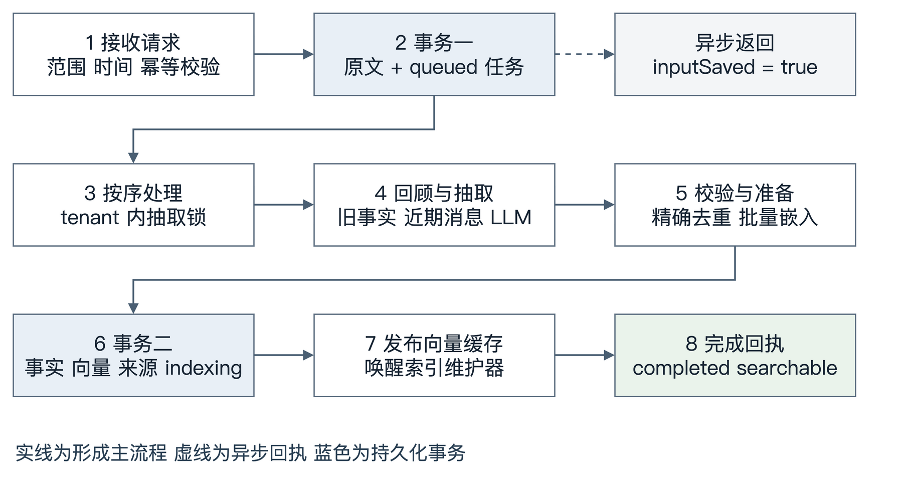
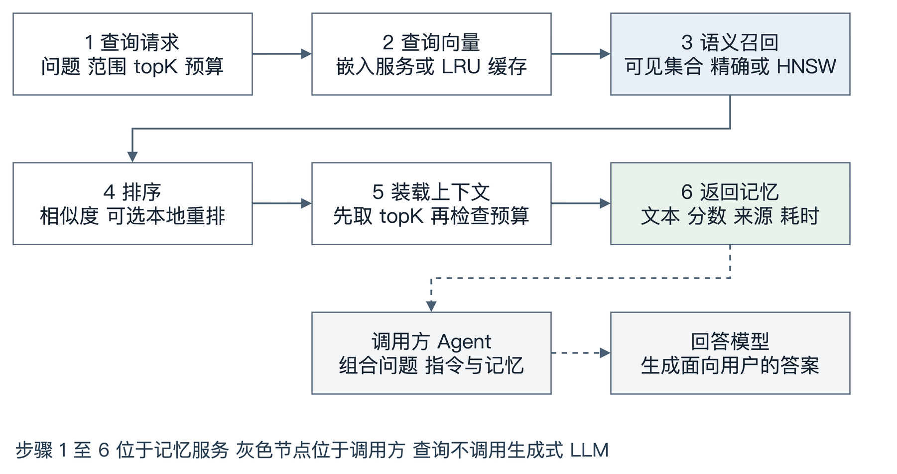

# Agent Memory Service 新方案设计与实现说明

版本日期：2026 年 10 月 12 日。本文以当前工作区代码为准，说明默认 `mem0` 策略；保留的旧实现通过 `memos` 策略选择。报告中的运行数据来自已完成的完整 LoCoMo 实验，本次撰写没有重新调用付费模型或重跑数据集。

这套方案把每次输入作为一个可恢复的任务：先保存完整消息，再利用相关旧记忆和近期消息，让 LLM 抽取新的事实；随后批量生成向量，将事实、向量和来源一起提交。查询时，把问题转为向量，筛选可见记忆，按相关性和上下文预算返回结果。最终回答由调用服务的 Agent 生成。

“新方案”指在现有 Rust 服务中实现 Mem0 2.2.1 的增量抽取和语义检索思路。服务仍使用 SurrealDB / SurrealKV 持久化；它没有在内部运行 Mem0 Python SDK，也没有把数据库改成 Qdrant。实验中的 `mem0-sdk` 才是独立运行的本地 Mem0 OSS 对照。

## 1 现有方案与改进目标

保留的 `memos` 方案以经过来源校验的事实为基础，分阶段形成经验、画像和技能。对话事实抽取按批次或手动刷新触发；经验和会话总结在会话结束后生成。检索组合向量、全文、实体和时间通道，处理更新链、来源片段和上下文组织。

这些能力适合需要可验证证据、修订和复杂知识管理的场景，也增加了保存阶段的模型任务、检索通道和上下文组织工作。过去的 LoCoMo 比较还存在语料、上下文预算和评价方式不一致的问题，历史分数不能直接当作新旧算法差异的证据。

新方案的目标是先建立一条容易测量的路径：输入批次通常只做一次增量抽取；保存过程中完成向量生成；查询默认只做语义检索，不触发生成式模型。原始输入、失败日志和显式纠错能力继续保留，使流程简化后仍能追查结果。

| 设计项 | 保留的 `memos` | 默认的 `mem0` |
| --- | --- | --- |
| 自动形成 | 事实，以及独立的会话结束经验和维护任务 | 每次输入任务抽取新增事实 |
| 抽取上下文 | 来源约束、批次及阶段相关上下文 | 最近 10 条消息、相关旧事实、本批新消息 |
| 来源粒度 | 经过校验的来源片段；部分场景含问答上下文 | 完整输入批次引用，未校验逐条事实引用片段 |
| 自动更新旧事实 | 有关系、修订链等处理 | 不自动覆盖；通过显式纠错或删除改变旧断言 |
| 默认检索 | 多通道融合、重排及上下文组织 | 语义相似度；重排可显式启用 |
| 会话结束 | 触发独立的 P2 工作 | 结束一个有序输入任务，不生成 P2 |

这不是将所有复杂能力删除。策略开关同时选择对应的形成和检索模块，管理接口仍然共用。旧方案保留作为对照，新方案不把旧来源记录重新解释成新的批次来源。

## 2 代码分层与核心数据

### 各层职责

HTTP / MCP 层负责接收请求和确定调用方；形成层负责把输入变成事实；检索层负责找出可见事实并装入预算；运行时负责模型连接、任务调度和缓存；存储层负责事务和持久化。排序和内容去重规则放在纯 Rust 规则库中，不依赖数据库或模型。

| 层 | 主要代码 | 本方案中的职责 |
| --- | --- | --- |
| API | `api/http.rs`、`formation/ingest.rs` | 参数校验、接口路由、策略选择、任务回执 |
| 形成 | `memory-algo-mem0/src/formation.rs` | 有序输入、提示词、输出校验、去重、提交事实 |
| 检索 | `memory-algo-mem0/src/retrieval.rs` | 可见范围、语义召回、可选重排、预算装载 |
| 运行时 | `memory-engine/src/runtime/engine.rs`、`llm.rs`、`models.rs`、`indexer.rs` | 恢复、LLM 重试、向量服务、缓存和索引维护 |
| 存储 | `memory-store/src/store.rs` | SurrealKV 事务、记录查询、持久索引任务 |
| 纯规则 | `memory-rules/src/mem0.rs` | 内容标识、相似度排序和稳定的同分次序 |

`memory-domain/src/types.rs` 定义共享请求和记录类型。代码从 `formation/ingest.rs::add_memories` 和 `retrieval/mod.rs::search_memories` 进入公共服务层，再由 `memory-service/src/algorithms.rs` 选择完整算法。`memory-algo-mem0` 与 `memory-algo-memos` 两个 crate 分别拥有形成、检索与后台生命周期；后者使用配置名 `memos`。两者共用存储、模型客户端、索引、指令和记录管理组件。

### 消息 记忆和向量

原始消息是用户或助手说过的完整文本。记忆文本是抽取模型生成的、适合日后检索的事实表达；它可能重写指代或补充日期。向量是嵌入模型计算的数值表示，用于相似度检索，不能代替原始消息。项目、来源、状态和模型版本等字段由服务管理，不能任由 LLM 决定。

| 记录 | 关键内容 | 为什么需要 |
| --- | --- | --- |
| `requests` | 原始 `inputMessages`、范围、`inputSeq`、状态、记忆 ID、失败次数 | 输入先落盘；重启继续任务；检查抽取是否完成 |
| `memories` | 事实文本、状态、项目范围、来源、时间、向量及模型标识 | 持久化的检索对象；向量可据文本重建 |
| `mem0_hashes` | 内容键到记忆 ID 的映射 | 避免同项目下相同文本重复入库 |
| `mem0_sources` | 输入请求 ID 列表、观察时间、归属、批次来源声明 | 找回完整原文，不冒充逐事实证据 |
| `mem0_history` | 新增事件及关联记录 | 保留新增操作轨迹 |
| `index_tasks` / `index_meta` | 待处理索引操作、模型版本和顺序计数 | 索引维护可恢复；检测模型变更 |
| `llm_responses` / `llm_usage` | 模型原始响应、校验结果、调用和 token 记录 | 定位模型错误与保存成本 |
| `extract_log` / `retrieval_log` | 抽取过程、返回记忆、阶段耗时 | 解释一条记忆如何产生、一次查询如何返回 |

每个 tenant 使用独立的本地存储目录和缓存。项目事实可以在同项目的不同 platform 之间可见；session 主要组织输入，不把事实检索限制在当前会话。`X-Memory-Tenant` 和 `X-Memory-Platform` 是调用路由信息，没有身份认证能力，服务按现有约定监听本机回环地址。

时间也分开记录：`recordedAt` 是事实入库时间，内部 `statedAt` 使用本批第一条消息的观察时间；未知的事件生效时间 `effectiveAt` 留空。一个批次包含多个日期时，这个批次观察时间不是每条事实的精确事件时间。

## 3 保存的实现流程



图 1 中，事务一保存输入，事务二保存形成结果。异步请求在事务一之后就可以返回；只有向量发布完成后，任务才标记为可检索。

### 输入校验与幂等接收

以下是说明用的请求，消息和输出均为示例，不是模型实测记录：

```json
{
  "scope": {"project": "travel", "session": "planning-01"},
  "turnId": "travel:planning-01:batch-001",
  "messages": [
    {
      "role": "user",
      "content": "我准备在2026年12月去新西兰南岛旅行，喜欢轻徒步。",
      "timestamp": "2026-10-12T09:00:00+08:00"
    },
    {
      "role": "assistant",
      "content": "可以把轻徒步安排进南岛行程。",
      "timestamp": "2026-10-12T09:00:05+08:00"
    }
  ],
  "sync": false
}
```

调用 `POST /v1/add_memories`，由连接提供 platform，并选择 tenant。共享入口要求 project 和 session；在 `mem0` 模式，`messages` 接受 1–128 条 user / assistant 消息，时间必须是 RFC3339 且按非递减顺序排列，必须提供 `turnId`。`text` 与 `messages` 互斥；文本入口限制为 4096 字节，并转成一条当前时间的 user 消息。

同一 tenant 内，幂等键由 **platform 与 turnId** 组成，不包含 project 或 session。调用方应像示例一样把项目、会话和批次编码进 `turnId`，并确保同一 platform 下不会复用它。以相同键重试会返回原任务；改变请求内容不会覆盖已保存输入。

`enqueue` 持有接收锁，在事务一中递增 `mem0_sequence`，保存完整消息及 `queued` 任务。此时 `formed=false`、`searchable=false`。事务成功后才唤醒抽取工作器。回执中的 `inputSaved=true` 只表示原始输入已保存。

默认 `messages` 异步返回，默认 `text` 同步等待；`sync` 可以覆盖这两个默认值。需要立即依赖检索结果的调用方应使用 `sync:true`，或轮询 `get_task` 等待 `completed`。

### 按输入顺序执行

`process_until` 在 tenant 的抽取锁内，按 `inputSeq` 处理 `queued`、`running` 和 `indexing` 任务。同一 tenant 的不同项目也共用这条有序形成队列。模型提示词会读取前序输入和已经形成的事实，因此后一个任务不能先于尚待重试的前一个任务抽取。

这使输入状态容易解释，也带来队列等待：一个项目的模型重试可能延后同 tenant 中其他项目的形成。不同 tenant 可以并行，LLM 客户端另有全局并发上限。并发上限与输入队列是两个层面的控制，不能将上限调高就假定同 tenant 的形成任务会并行。

### 增量抽取的上下文

`form` 把本批角色和全文拼成查询，先做一次语义检索，取最多 10 条相关旧事实。这里的召回阈值是 -1.0，用于把相关旧事实交给抽取模型，区别于对外搜索的默认阈值 0.1。

再读取同 project、同 platform 的前序输入，取最后 10 条消息，每条仅在提示词中保留前 300 个字符。完整原文仍保存在 `requests` 中。该历史选择不要求前序任务已成功，因此已经接收但最终失败的原始消息也可能进入后续提示词。

提示词沿用仓库中固定的 Mem0 2.2.1 additive 模板，第三方 LICENSE 和 NOTICE 一并保留。各部分的实际内容如下：

| 提示词部分 | 当前内容与作用 |
| --- | --- |
| `Summary` | 空；本方案不维护自动生成的会话总结 |
| `Last k Messages` | 最近 10 条前序消息的截短表示，帮助理解指代 |
| `Recently Extracted Memories` | 空数组 |
| `Existing Memories` | 最多 10 条相关旧事实，供模型判断重复和关联 |
| `New Messages` | 当前输入批次，要求抽取新增信息 |
| `Observation Date` | 本批第一条消息的日期，帮助解释相对时间 |
| `Current Date` | 当前 UTC 日期；与历史消息日期分开 |
| `Custom Instructions` | 配置中非空时加入，用于业务约束 |
| `Language Requirement` | 中文提示词模式下加入同语言、同文字要求 |

正常路径只有一个生成式模型调用。这里的“一次调用”指一次成功的抽取，不包括向量服务请求，也不排除输出错误时的有限重试。没有额外的“更新旧记忆”LLM 阶段。

### 模型候选与服务记录身份

输出使用严格的 `mem0-additive-v1` 结构，例如：

```json
{
  "memory": [
    {
      "id": "0",
      "text": "用户计划于2026年12月前往新西兰南岛旅行。",
      "attributed_to": "user", "linked_memory_ids": []
    },
    {
      "id": "1",
      "text": "用户喜欢轻徒步。",
      "attributed_to": "user", "linked_memory_ids": []
    }
  ]
}
```

候选 `id` 必须是从 `"0"` 开始连续编号的字符串，不能是 JSON 数字；最多 128 项，文本非空且每项不超过 8192 字节，归属只能是 user 或 assistant。未知字段会被拒绝。

交给模型的旧事实也使用临时字符串编号。`linked_memory_ids` 只能引用本次 `Existing Memories` 中的编号。新候选编号和旧事实编号属于不同列表，都不是数据库 ID；正式记忆 ID 由服务生成。模型无法通过这个结构指定可见范围、状态或数据库记录身份。

目前，`linked_memory_ids` **只进行类型和引用合法性校验，没有写成关系边，也没有填入记忆的 `related` 字段**。因此不能据此声称新方案已经实现记忆图谱或自动关系检索。

`memory-engine/src/runtime/llm.rs` 在解析前先持久化模型原始响应，再执行 JSON 和结构校验。新方案最多尝试 6 次，每次修复提供原始任务、具体字段错误和输出结构，不回显有问题的 assistant JSON。重试退避为 2、4、8、16、32 秒。这样既能审计错误，也避免数值 ID 等错误结构在对话中不断被复制。

### 去重与向量化后的提交

校验通过后，服务以 project、精确文本和 inferred / raw 模式计算内容键。同批次的重复先在内存中去除；已有键指向有效旧记忆时复用其 ID，并将当前输入请求追加到来源列表。相同项目的重复可以跨 platform 复用；不同项目、原文直存与推断形成使用不同内容键。

这种去重识别的是相同文本，不会自动合并“喜欢徒步”和“偏好徒步旅行”等语义近似表达，也不会把“现在喜欢高强度徒步”自动替换成旧偏好。

仅对真正新增的文本批量调用嵌入模型。LLM 负责提取文字，BGE-M3 等嵌入模型负责生成向量；二者职责和耗时独立。向量生成成功后，事务二一次提交以下记录：

1. `memories`：新增 fact，状态 current，项目范围、文本、来源、向量和模型标识。
2. `mem0_hashes`、`mem0_sources`、`mem0_history`：内容标识、批次来源和新增轨迹。
3. `index_tasks`：带 `upsert_preindexed` 标记的索引任务。
4. `requests`：保存 `memoryIds` 和阶段耗时，变为 `indexing`，设置 `formed=true`、`searchable=false`。

这四类修改作为同一个主存储事务提交。模型和嵌入调用不放在数据库事务内，以免长时间占用写锁。事务提交后，服务将向量发布到 tenant 的向量缓存，通知索引维护器，最后把任务改为 `completed`、`searchable=true`。

完全重复或没有可抽取事实的输入也可以正常完成；完成不保证一定新增一条记忆。`infer:false` 会跳过语义回顾和 LLM，把非空消息原文作为 fact 候选，随后仍走去重、嵌入和提交。它不等于显式指令写入。

## 4 任务状态与崩溃恢复

三个时点需要分别理解：**输入已保存**意味着原文可恢复；**记忆已形成**意味着事实和向量已提交；**记忆可检索**意味着查询所需的向量已经发布。后台全文维护是否全部完成是另一件事。

| 状态 | 持久状态与调用方含义 | 后续处理 |
| --- | --- | --- |
| `queued` | 原始输入已保存，尚未形成结果 | 按顺序开始，或等待任务级退避 |
| `running` | 模型、去重或嵌入处理中 | 成功后提交事务二；重启可能重新形成 |
| `indexing` | 事务二已提交，`formed=true` | 读取已存向量并重新发布，无需再次抽取 |
| `completed` | `formed=true`、`searchable=true` | 可以依赖新记忆进行语义查询 |
| `failed` | 形成达到任务级失败上限，原文仍保留 | 诊断错误后显式处理；不计为成功形成 |

`process_until` 对形成失败记录错误和失败次数，累计达到 5 次后标记 failed；未达上限时重新入队并设置退避时间。该任务级重试之外，每次 LLM 抽取还可能执行最多 6 次契约尝试。应用应结合两个层面的日志计算调用成本，不能把“一个输入”简单等同于“一次付费请求”。

同 tenant 的队列在前序任务退避期间暂停后序形成；永久失败的任务离开活跃队列后，后续输入可以继续。同步等待可能先返回模型不可用错误，而原始任务仍在等待后续重试；使用原 `turnId` 查询或重试，可以找回原请求。

| 中断位置 | 恢复依据 | 是否可能再调用模型 |
| --- | --- | --- |
| 事务一之前 | 尚无成功接收记录，调用方重试 | 是 |
| 事务一之后、事务二之前 | 原始输入和任务；已有响应日志用于审计 | 是，模型完成日志不是可复用的形成检查点 |
| 事务二之后、向量发布完成之前 | `indexing` 回执及已存向量 | 否，由 `publish_committed` 重新发布 |
| `completed` 之后 | 主记录、向量和幂等键 | 重复提交返回原任务 |

这保证的是输入不因模型失败丢失，以及已提交结果可以恢复发布；不保证“模型调用恰好一次”。例如模型响应已记录但事实事务尚未提交时崩溃，恢复后可能再次调用模型。

`wait_idle` 还会排空索引任务，并返回 `failedRequests`。`idle` 表示没有活跃任务，不表示所有历史输入都成功。同步等待中约 120 秒的检查在任务执行之外，长模型调用可能跨过这个时限；当前它不是严格的端到端硬超时。

## 5 检索的实现流程



### 在同一向量空间中查找可见事实

请求示例：

```json
{
  "query": "用户打算什么时候去哪里旅行？",
  "scope": {"project": "travel"},
  "topK": 20,
  "tokenBudget": 2000,
  "rerank": false,
  "includeEvidence": true,
  "touch": false
}
```

`search` 校验查询和预算后，只生成一次查询向量，调用 `dense_with_vector`。模型运行时带有容量 50,000 的嵌入 LRU 缓存，所以相同文本的后续查询可能省去向量服务调用。首次查询和热缓存查询必须分别计时。

检索先依据记录元数据构造可见 ID 集合：检查 project / platform 范围、类型和有效状态。候选状态、过期派生记录或删除记录不会成为新方案事实结果。默认类型是 fact；显式 instruction 不通过相似度选择。

可见集合不超过默认 20,000 条时，直接在内存向量缓存中计算精确余弦相似度。超过该规模时，使用 SurrealDB 中的 HNSW 索引扩大候选召回，并做可见 ID 过滤；初始扩大候选数，最多尝试 3 轮。加载完整记忆后再次检查状态和可见性，防止缓存或异步索引仍含无效记录。

这个阈值取决于一次查询的可见集合，不是所有 tenant 的记忆总数。完整 LoCoMo 实验没有验证超过 20,000 条可见记忆后的 HNSW 性能。

### 排序与上下文预算

默认 `mem0Threshold=0.1`，召回数量为 `max(4 × topK, 60)`。按相似度降序排序，同分使用记忆 ID 保持稳定。若显式启用 rerank，再由本地重排模型计算候选相关性；不使用生成式 LLM。默认不加载和调用重排模型。

排序后先取 topK，再按分数顺序装入完整记忆。每条成本按文本的近似 token 数加 8 计算，超出剩余预算则跳过，不截断事实文本。由于 topK 在预算装载之前已经截取，某条过长被跳过后，不会继续从第 topK+1 条补位。

因此 `tokenBudget` 约束的是本服务的近似记忆文本预算，不是下游整个模型提示词的严格 token 上限。业务调用方仍需为指令、用户问题、消息包装和最终输出预留空间；LoCoMo 评估器另用统一 tokenizer 对最终上下文实施精确的 2000-token 限制。

结果包含 `results`、`score`、`tokensUsed`、`gap` 和分阶段 `latencyMs`。每次查询还保存 `retrieval_log`。默认 `touch=false` 不更新最后访问时间；开启后会增加逐条记录写入工作。

### Agent 如何使用返回内容

`search_memories` 不回答用户问题，不改写查询，也不在读取时形成新记忆。新方案响应中的 `profiles`、`recentTurns`、`uncertainties` 是空数组。业务 Agent 取 `results[].memory.text`，结合问题和系统指令构造回答提示词，然后调用自己的回答模型。

显式指令通过 `memoryType:instruction` 写入共享指令路径，由 `get_context` 按范围选取。`get_context` 仍能读取已有的共享画像和技能，但新方案不自动形成新的画像、经验或技能。业务应用需要这些信息时，应分别调用和预算它们，不能假定事实查询已包含完整 Agent 上下文。

`includeEvidence:true` 返回的 `sourceBatch` 指向完整输入请求。它声明 `level:batch`、`verifiedClaimSpan:false`，说明这条事实来自哪个输入批次；它没有指出哪一句话逐字支持了事实，也没有证明助手发言一定真实。需要证据时，应再读原始消息，由业务审核或新增证据校验阶段确认。

共享请求结构中的 `asOf`、`includeHistory`、`includeRecent` 不在当前新检索路径中生效。session 也不是事实筛选条件。事件日期主要由记忆文本表达，不能将当前实现理解为按指定历史时点查询的记忆快照。

## 6 数据存储和索引维护

服务将 SurrealDB 作为嵌入式数据库，使用 SurrealKV 存储引擎。事实文本、向量和任务回执共用主存储事务，不需要协调独立向量数据库的跨库提交。

启动时，`Engine` 校验存储完整性，比较嵌入模型 ID、维度和索引配置，再载入已保存向量。模型或量化版本改变时会安排索引重建；不能把两个不同模型的向量直接混在同一个相似度空间里。

`memories.embedding` 上定义 HNSW 索引；小集合检索使用内存向量缓存。共享的 `index_tasks` 还负责缓存和全文索引维护。新入库任务使用 `upsert_preindexed`，在已保存向量的模型一致且缓存已存在时不重复嵌入；模型不一致或普通重建任务仍按通用索引路径处理。

这解释了为什么 `completed` 不等于 `index_tasks` 已清空：新事实已具备语义检索条件时，全文维护仍可继续。需要检查全部维护任务时使用 `wait_idle`，并查看失败数。

在实验配置中，嵌入和可选重排由外部 llama-server 提供，LLM 使用 Qwen 的兼容接口。模型权重不随代码或报告分发。保存等待主要由远端生成和失败退避决定；检索等待主要来自查询嵌入、候选读取、重排和组装。

## 7 配置与调用方式

### 默认行为与实验设置

| 设置 | 服务默认 | 完整 LoCoMo 中的设置或约定 |
| --- | --- | --- |
| `memoryStrategy` | `mem0` | 新方案与独立 SDK 分别运行 |
| `mem0TopK` | 20 | 每个人物视角取 30，之后共用最终预算 |
| `mem0Threshold` | 0.1 | 保持 0.1 |
| `mem0Rerank` | false | 关闭 |
| `mem0MaxTokens` | 2000，抽取输出上限 | 8192，避免大批抽取输出截断 |
| `defaultTokenBudget` | 2000，近似记忆预算 | 最终上下文严格限制为 2000 token |
| `mem0CustomInstructions` | 空 | 双方使用相同的 LoCoMo 人物视角约束 |
| `promptVariant` | zh | en |
| 输入批次 | 调用方提供，1–128 条消息 | 每批 8 条；两个说话人视角分别存储 |
| 同步方式 | messages 异步，text 同步 | 保存批次使用 `sync:true` |

8 条消息和两个说话人视角来自 LoCoMo 调用适配器，不是服务自动分批规则。`mem0MaxTokens` 控制形成输出，`tokenBudget` 控制查询结果，两者不能相互替代。

直接运行二进制时，LLM 并发默认值为 24；`scripts/serve.py` 包装器默认传入 1，并默认设置 60 次模型尝试上限。这些是启动方式的差别，应显式记录实际参数。

### 推荐调用约定

业务应用以一次已完成的消息批次为输入，提供稳定、全局不复用的 turnId。只要需要完整时间信息，就使用带真实时间戳的 messages；text 的时间是接收时间。异步保存后依据 requestId 观察完成状态，不能用输入回执直接推断记忆已经可查。

查询显式填写 project，避免默认 `project:*` 覆盖整个 tenant 的项目事实。把行为要求写成 instruction，通过 `get_context` 选择；把用户事实走普通形成路径。用户纠正事实时调用 `correct_memory`，而不是仅提交一句新话并期待旧事实被自动撤销。

使用已有 `.env.example` 配置模型连接、`examples/service-config.json` 配置算法选项，字段含义见 `docs/api.md`。启动和编译示例：

```sh
make build
.venv/bin/python scripts/serve.py --memory-strategy mem0 \
  --data-dir results/service-demo-mem0-store --llm-concurrency 1
```

`make build` 已固定为 `cargo build --locked -p memory-service --bin agent-memoryd --profile fast`，生成 `target/fast/agent-memoryd`。真实运行前按既有配置启动嵌入服务，并设置本地密钥；密钥不写入命令示例和报告。用于无付费验证时给包装器增加 `--mock`。

demo 在启动时选择一种算法：`--memory-strategy mem0` 或 `--memory-strategy memos`。整个进程及其中的所有 tenant 固定使用这一算法，请求处理不改变算法选择。两种 demo 使用各自的数据目录；公平基准分别建立干净存储，记录语料、模型、参数和上下文指纹。

## 8 完整 LoCoMo 验证结果

以下数据摘自本地已完成实验 `eval/results/locomo-full-mem0-20261011-v3`，与设计分析分开陈述。实验覆盖 10 段对话、272 个会话、5882 条原始发言；每个系统按两个视角处理 11764 条输入消息、1696 个批次，使用全新存储。

双方共用 Qwen3.8-Flash、非思考模式、温度 0、8192-token 抽取输出上限、BGE-M3 Q8_0 嵌入，以及相同回答和评判提示词。检索完成 3 遍，保留首遍与热缓存两遍；最终上下文的精确预算和稳定性经过审计。

| 指标 | 新方案 `mem0-strategy` | 本地 Mem0 OSS 2.2.1 |
| --- | --- | --- |
| 标准问答正确数 / 总数 | 1267 / 1540 | 1270 / 1540 |
| 标准 J 通过率 | 82.27% | 82.47% |
| 标准文本 F1 | 52.75% | 52.52% |
| 累计同步批次保存耗时 | 5789.9 秒 | 5266.2 秒 |
| 形成阶段实际墙钟时间 | 692.2 秒 | 618.8 秒 |
| 首遍检索均值 / P95 | 36.2 / 41.9 毫秒 | 30.9 / 38.4 毫秒 |
| 热缓存检索均值 / P95 | 24.1 / 26.0 毫秒 | 26.2 / 30.1 毫秒 |
| 保存记忆数 | 4000 | 3958 |
| 形成模型尝试数 | 1782 | 1698 |

J 指共用评判流程对答案正确性的通过率，F1 衡量与参考文本的重合。配对题目中，新方案独对 80 题，SDK 独对 83 题。此次标准正确率差为 0.20 个百分点，不能据单次结果宣称算法显著更优或更差。

保存耗时需要两个口径。累计耗时是 1696 个同步保存批次的耗时相加；实际墙钟是同等对话并发下的形成阶段耗时，包含启动和导出。前者不是单线程运行时间，也不是数据库吞吐量。

新方案累计保存耗时约多 9.95%。远端模型耗时占批次累计时间的 90.43%，SDK 为 94.09%；新方案有 86 次契约修复调用，SDK 有 2 次 JSON 修复。差额包括更多模型生成、退避和本地处理。现有记录没有把数据库和所有本地开销单独隔离，不能将剩余差额全部归因于 SurrealDB。

还有 446 道 category 5 对抗题，使用另行声明的语义拒答扩展，新方案通过率 50.90%，SDK 为 54.93%。它们没有纳入标准 J / F1；`summary-unified.json` 的混合总分也不能代替表中标准分数。

本次 SDK 使用本地 Qdrant，缺少可选 fastembed / spaCy 功能，只评估语义路径，不代表 Mem0 托管平台或论文中的全部能力。远端提示词缓存与执行顺序没有完全控制；完整数据也包含此前用于开发的小样本，不能称为未接触的独立测试集。全量测试只比较新方案和 SDK，未重跑 `memos`（历史标签为 `current`），故此处不拼接旧方案历史分数。

原始证据包括 `comparison.md`、`completion-audit.json`、`paired-analysis.json`、固定协议、源码和二进制指纹、各批次输入及响应、三遍检索、上下文、回答和评判结果。本报告只引用汇总事实，不复制数据库、密钥、模型权重或大量原始对话。

## 9 已实现边界与后续改进

新方案当前实现了持久有序输入、单阶段增量抽取、严格输出契约、精确去重、批量向量提交、提交后恢复发布和无生成式调用的语义检索。它仍然是文本事实服务，以下能力需要单独设计，不应由配置名或接口字段推断为已经实现。

| 当前边界 | 影响 | 可后续实施的改进 |
| --- | --- | --- |
| 来源仅到批次，未验证逐事实引用 | 审核事实时仍需读完整批次 | 抽取时返回可定位片段，服务验证原文、角色和引用范围后再声明证据 |
| 新旧矛盾不会自动替换 | 当前偏好可能同时检出多个版本 | 优先让应用显式纠错；若自动更新，再增加验证、历史和原子状态转换 |
| 关联编号未落库 | 不能进行关系遍历 | 明确关系类型、方向和可见性，再将通过校验的关联写入专用记录 |
| 事件日期留在文本，历史筛选未实现 | 时间查询依赖语义，不能保证快照正确 | 区分 observation / stated / effective 时间，建立确定性的历史可见规则 |
| tenant 内统一队列 | 某项目重试可能阻塞其他项目 | 按有状态上下文实际依赖分队列；保持同一上下文顺序和崩溃恢复 |
| topK 先截取，再检查预算 | 过长记忆可能导致预算未充分利用 | 预留候选后补位，或优化长事实表达；用固定协议检查质量变化 |
| 契约修复次数仍较多 | 增加保存时间与模型成本 | 基于真实字段错误改进提示和输出约束，继续保留严格验证与原始日志 |

这些属于建议，不是本报告新增的实现。下一轮修改应保持职责分层，以代码和失败记录解释触发条件，使用冻结的协议验证；不依据先导得分反复调整召回阈值或 topK。性能优化优先测量模型修复、队列等待、嵌入、事务和日志的分项耗时，再决定改哪里。

## 10 代码阅读与问题定位

### 一条请求的阅读路线

建议先读入口和记录类型，再跟踪两条主链，最后看运行时和存储。下表中的行号以本次报告时的工作区为准；代码后续修改时以函数名定位。

| 要理解的问题 | 代码位置和关键函数 |
| --- | --- |
| 默认选哪个策略 | `crates/memory-config/src/lib.rs:8`，`MemoryStrategy`；默认 Mem0 |
| 请求怎样进入形成模块 | `formation/ingest.rs`，`add_memories`；指令先走共享路径 |
| 原始输入在哪里落盘 | `memory-algo-mem0/src/formation.rs`，`enqueue`；事务一 |
| 顺序、失败和恢复怎样工作 | `memory-algo-mem0/src/formation.rs`，`process_until`；`publish_committed` |
| LLM 输入如何拼装 | `memory-algo-mem0/src/formation.rs`，`form`；`memory-algo-mem0/src/prompts/additive.txt` |
| 字段错误怎样校验 | `memory-algo-mem0/src/formation.rs`，`validate_output`、`contract` |
| 响应先记日志还是先解析 | `memory-engine/src/runtime/llm.rs`，`contract_call_logged`、`corrective_messages` |
| 内容去重和排序规则 | `memory-rules/src/mem0.rs`，`content_key`、`rank` |
| 事实与向量怎样提交 | `memory-algo-mem0/src/formation.rs`，`form` 的事务二；`memory-store/src/store.rs::commit` |
| 查询如何调用嵌入、选择结果 | `memory-algo-mem0/src/retrieval.rs`，`search`、`dense_with_vector` |
| 模型与缓存在哪里 | `memory-engine/src/runtime/models.rs`，`ModelHub::embed`、`embed_uncached`、`rerank` |
| 索引为什么不会重复嵌入 | `memory-engine/src/runtime/indexer.rs`，`upsert_preindexed` 处理分支 |
| 启动后如何恢复 | `memory-engine/src/runtime/engine.rs`，`warm`；存储完整性与模型版本检查 |
| 为什么新方案没有自动 P2 | `memory-service/src/algorithms.rs`，按算法注册后台任务；P2 与维护只属于 memos |
| 完整测试如何组织输入和评价 | `eval/locomo_full.py`、`eval/mem0_migration.py`、`eval/answer_and_judge.py` |

上表路径中以 `memory-` 开头的相对 `crates/`，其余相对 `crates/memory-service/src/`。完整接口类型见 `crates/memory-domain/src/types.rs`（存储见 `crates/memory-store/src/`），配置和调用约定见 `docs/api.md`。

### 从现象回到证据

“刚保存搜不到”先检查 requestId 的 status / formed / searchable。如果仍是 queued / running，检查顺序队列、retryAt 和模型日志；如果已 completed，再检查查询 project、范围、类型、阈值以及 `retrieval_log.returned`。

“答案不对”按三处拆解：在原始 `requests.inputMessages` 中确认信息；在 `memories.text` 中确认是否抽取正确；在检索记录和最终回答提示词中确认是否召回并装入上下文。抽取失败、检索遗漏和回答模型误用不能用一个准确率数字混为同一问题。

“保存太慢”查看任务记录中的形成阶段耗时、模型尝试和退避，再结合 `llm_usage` / `llm_responses`；“查询太慢”查看 `latencyMs` 的 embed、recall、rerank、assemble。总耗时还含日志等工作，因此不要求四项之和严格等于 total；应用侧也应测量队列和 HTTP 时间。

形成或检索代码变更后，按仓库要求使用 Fast build，运行纯 Rust 测试、mock selftest 和相关 Python 测试：

```sh
make build
make test-rust
make selftest
make test
make fmt
```

其中 `make selftest` 已设置 `MEMORY_MOCK_MODELS=1`。付费模型调用和全量 LoCoMo 属于明确授权的实验，不作为日常自动验证步骤。本次文档交付只做源码核对、流程图和文档渲染检查。

## 附录 实现依据与交付材料

实现依据为当前工作区的形成、检索、运行时、存储和纯规则代码，以及 `docs/api.md`、`docs/architecture.md`、`.env.example`、`examples/service-config.json` 和 Makefile。第三方 additive 提示词及许可位于 `crates/memory-service/src/algorithms/mem0/prompts/`。

实验依据为 `eval/results/locomo-full-mem0-20261011-v3/comparison.md` 和完成审计；这些实验材料按仓库规则保留在本地，不进入公共版本库。图 1 和图 2 的可编辑源文件分别为 `docs/diagrams/mem0-write-flow.drawio`、`docs/diagrams/mem0-read-flow.drawio`，PNG 中亦嵌入 draw.io 源数据。
